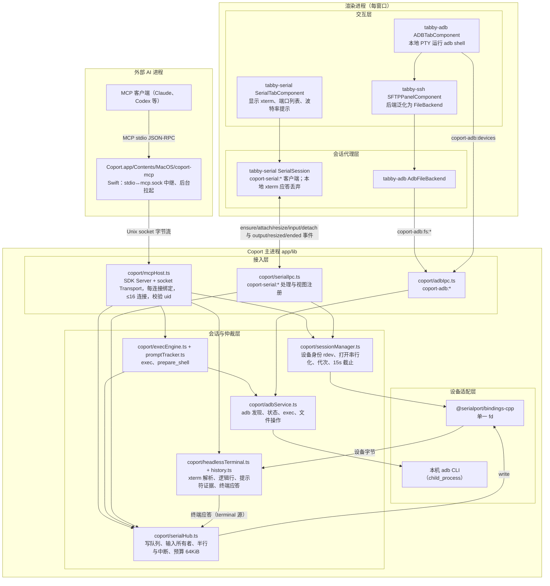
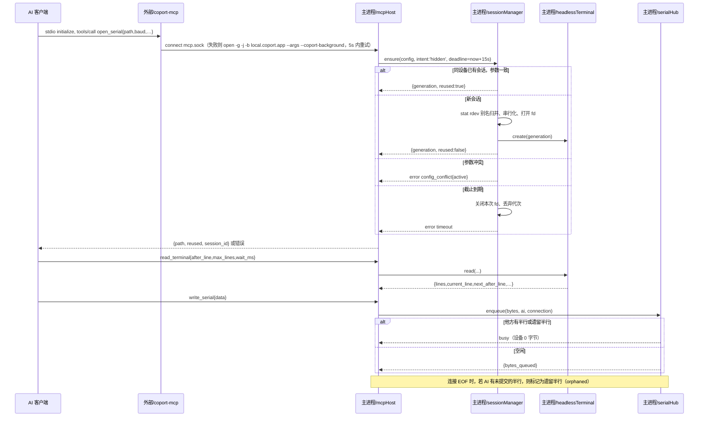
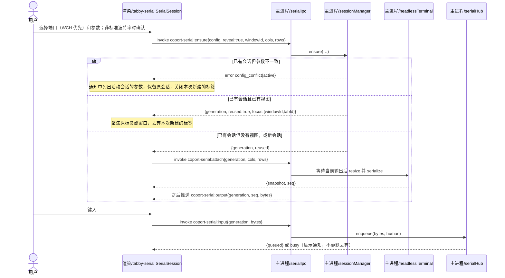
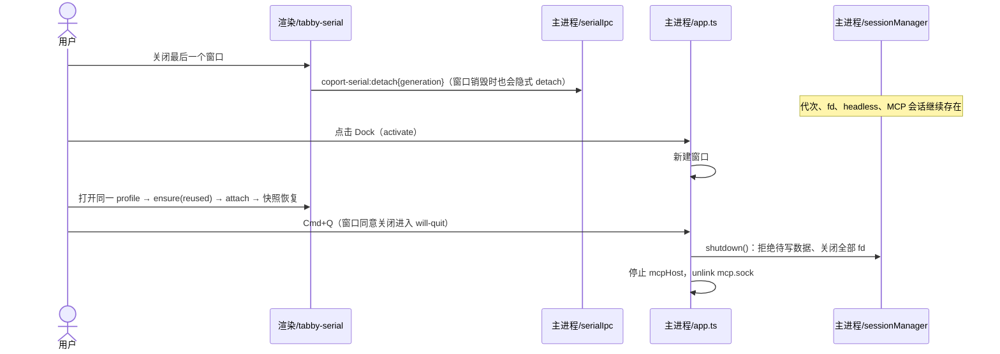
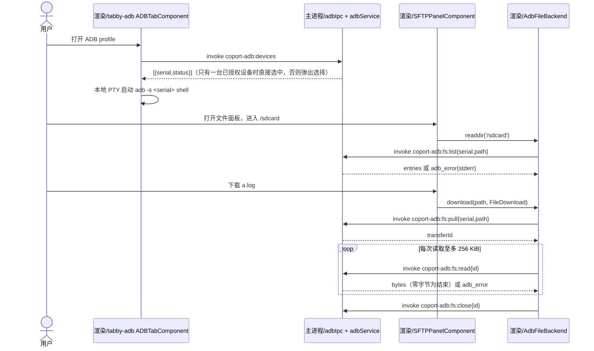

# Coport（Tabby fork）首版

交付分级：L。本方案把 Coport 的共享串口、MCP 和 ADB 能力并入 Tabby v1.0.238 的 fork（`main` = `54869e1`），形成一个有机整体的 macOS 应用，取代原 Swift Coport App（基线 `2c1ea46`）。本文定稿第一期范围。

终端解析器的宿主已由用户在 G2 选定为"主进程 headless"。该选择依赖 M0 预研 P1 准出；若 P1 未准出，自动回退为"隐藏 owner 窗口"（见 P1 失败处理）。两种宿主的对外协议和验收标准相同。

## 需求与验收

目标：只用一个应用。人和 AI 共用唯一的一种串口；ADB 终端和文件浏览沿用 Tabby 原有的交互形态；已接入的 AI 客户端只需更换 `coport-mcp` 路径即可继续使用。
范围：品牌与打包、共享串口与防拼接仲裁、MCP、ADB Shell 及文件面板、三项遗留问题、生命周期、上游同步。
不做：Windows/Linux、本地缓存、AI 设置面板、原 Swift App 的后续维护。
可实施范围：下表全部需求。
后续待细化范围：日志查看器与高亮规则，放在第二期，目标是类似 Notepad++ 的编辑器，届时评估迁移 Notepad-- 等开源编辑器。第一期 `get_view_state` 固定返回 `log: null`，与本期没有共享依赖。

| 需求 | 条件与触发行为 | 可验证的通过标准 |
|---|---|---|
| R1 单一应用 | 从 fork 构建 macOS arm64 包并启动 | 产物为 `Coport.app`，appId 为 `local.coport.app`，`codesign --verify --deep --strict` 通过（ad-hoc 签名）。未安装原 Swift App 时可以独立运行。默认关闭自动更新，不初始化 Sentry，界面上没有更新入口 |
| R2 唯一串口 | 用 Tabby 原有的 serial profile 或快速连接打开串口；AI 调用 `open_serial` | 应用中只有 `serial` 一种串口 profile 类型，旧 serial 配置不需要迁移即可打开。同一物理设备（按 `st_rdev` 归并别名节点）在多个标签、窗口和 AI 之间只占用一个 fd；再次打开同一设备时前置已有标签，参数不一致时报冲突。同一适配器同时出现 `cu.wchusbserial<n>` 与 `cu.usbserial-<n>` 时，WCH 节点排在前面，苹果节点标注"苹果驱动，高波特率可能失真"。输入的波特率不在标准列表中时给出确认提示，但仍允许连接 |
| R3 防拼接仲裁一致 | 人和 AI 并发输入 | 以下行为与 Swift 实现一致：半行互斥（冲突方收到 busy，设备收到 0 字节）、Ctrl-C 接管、提前输入和迟到回显不拼接、AI 断开后遗留的半行受保护、提示符证据规则。移植后的 `scripts/sim` 共享串口回归全部通过 |
| R4 MCP 兼容 | AI 客户端经 `Coport.app/Contents/MacOS/coport-mcp` 接入 | 六个工具的名称、输入 schema、结果结构和错误结构都与原实现一致。应用未运行时在后台拉起，不出现窗口。已有客户端只需改路径（安装位置不变时无需任何改动） |
| R5 ADB Shell 与文件面板 | 打开 Coport ADB Shell 标签后打开文件面板 | 文件面板复用 SSH 的 SFTP 面板组件，支持浏览、上传（文件及目录）、下载、新建目录和删除。有已授权 ADB 设备时，`exec` 优先走 ADB |
| R6 遗留问题 | 新会话打开后没有人工输入；打开过程超时 | 打开瞬间设备吐出乱码、终端产生上报时，在没有真实半行的情况下 AI 写入不会返回 busy。主进程中的打开请求只有一个 15 秒的绝对截止时间（从请求进入主进程起算，覆盖串行化等待、打开设备和创建解析器），到期返回 `timeout`，并且不残留 fd 或会话。应用未运行时，`coport-mcp` 的拉起窗口（5 秒）在此之前单独计时，因此 AI 冷启动最长需要 20 秒 |
| R7 生命周期 | 关闭全部窗口、从 Dock 重开、退出、重启 | 关闭全部窗口后串口会话和 MCP 读写保持不变；重开窗口再打开同一 profile，回到原会话并恢复历史。退出应用释放所有 fd 并删除 socket。重启后不自动重连串口 |
| R8 可维护 | 代码审阅与同步上游 | 新增代码集中在 `app/lib/coport/` 和 `tabby-adb` 包中。对上游文件的修改全部登记在 `docs/coport/upstream-changes.md`；白名单之外的上游文件没有 diff（由脚本校验）；附季度同步流程 |

默认决定（用户授权代选）：
- 沿用 `local.coport.app` 身份。数据目录为 `~/Library/Application Support/Coport`，与原 App 相同，`mcp.sock` 路径不变。
- 原 App 退役，两者不同时安装。原 App 仍在运行时，新应用监听 socket 会得到 EADDRINUSE，此时明确报错，不抢占。
- 签名方式为 ad-hoc，与原构建一致。
- 每季度合入一次 Tabby 稳定版。
- serial profile 的配置格式保持兼容。原插件弹窗用的"按路径记忆参数"（`tabbySerialSettings`）只在开发和隔离环境中使用过，不做迁移；Tabby 的 profile 本身就保存这些参数。

## 业界方案调研与选型依据

调研围绕五个问题展开：设备由哪个进程持有、终端在哪里解析、MCP 如何内嵌、`coport-mcp` 的形态、ADB 文件如何访问。查证日期为 2026-11-26。

| 候选方案与复用方式 | 可复用能力、适配成本与适用边界 | 成熟度及关键假设证据 | 来源 | 取舍依据 |
|---|---|---|---|---|
| Tabby `PTYManager` 的主进程模式（复用模式） | 设备在主进程中存活，渲染进程通过 IPC 读写，按 ack 做流控 | 已有充分证据：上游生产代码 | [app/lib/pty.ts](../../app/lib/pty.ts) | 采用。串口按同样方式迁入主进程 |
| `serialport 11.0.1` / `@serialport/bindings-cpp`（直接复用） | fork 已为 Electron 43 构建了原生绑定；在 macOS 上通过 IOSSIOSPEED 支持非标准波特率 | 有条件可用：渲染进程中已在使用，与主进程 ABI 相同；G3 用同一个库在 CH340、921600 下验证通过。主进程中使用由 P2 验证 | `app/package.json`；原仓库 `docs/delivery/tabby-shared-serial-M3.md` | 采用 |
| Electron utilityProcess 承载设备 | 隔离原生崩溃 | 有条件可用：官方说明可用 Node API，但没有找到 serialport 在其中运行的一手资料 | [utilityProcess](https://electronjs.org/docs/latest/api/utility-process) | 排除。串口速率不超过约 1 MB/s，隔离带来的收益抵不过重新引入跨进程协调的代价 |
| `@xterm/headless` + `@xterm/addon-serialize`（适配复用） | 在主进程中解析、保存逻辑行历史、产生提示符证据、回应终端查询；视图挂载时用 serialize 恢复画面 | 有条件可用：与 `@xterm/xterm` 同源码；官方说明服务端保存状态、重连时恢复是常见用法。原 `history.js` 依赖私有钩子，由 P1 验证 | [xterm.js README（5.5.0，fork 锁定 ^5）](https://unpkg.com/@xterm/xterm@5.5.0/README.md)、[addon-serialize（fork 锁定 ^0.12）](https://www.npmjs.com/package/@xterm/addon-serialize) | 采用（用户 G2 选择），需 P1 准出 |
| 隐藏 owner 窗口中的渲染 xterm 作为唯一解析器 | 原插件的实现可以原样迁移，G3 已验证 | 已有充分证据 | 原插件 `history.js` / `views.js` | 作为 P1 失败时的回退 |
| `@modelcontextprotocol/sdk` v1（适配复用） | 用 `McpServer` 加一个自定义的 Unix socket Transport | 已有充分证据：v1 为稳定线，v2 仍在 pre-alpha | [TS SDK v1](https://ts.sdk.modelcontextprotocol.io/server)、[v2 说明](https://ts.sdk.modelcontextprotocol.io/v2/api/@modelcontextprotocol/server/server/serveStdio.html) | 采用并锁定小版本，由 P3 验证；失败则手写换行 JSON-RPC |
| `coport-mcp` 以 `ELECTRON_RUN_AS_NODE` 运行 | 不需要原生 shim | 关键能力不可用：`electron-builder.yml` 中 `electronFuses.runAsNode: false` | `electron-builder.yml` | 排除 |
| 复用原 Swift `coport-mcp`（直接复用） | `main.swift` 加 `UnixSocket.swift`，约 100 行，已经过 shim_autostart 回归 | 已有充分证据 | 原仓库 `Sources/coport-mcp/main.swift` | 采用。用 swiftc 编译后进行 ad-hoc 签名 |
| `@devicefarmer/adbkit`、`@yume-chan/adb` | 直接实现 ADB 协议 | 有条件可用：adbkit 在维护中；Tango 的 API 曾标注不稳定 | [adbkit](https://socket.dev/npm/package/@devicefarmer/adbkit)、[Tango](https://tango-adb.github.io/docs/) | 排除。原实现和 ADB Shell 都调用本机的 `adb` CLI，沿用它可以避免与 adb server 版本错配 |
| Tabby `SFTPPanelComponent` 的后端抽象（少量适配） | 面板只用到 readdir、stat、readlink、mkdir、upload、download，删除弹窗用到 rmdir 和 unlink | 已有充分证据：源码已核实 | [sftpPanel.component.ts](../../tabby-ssh/src/components/sftpPanel.component.ts) | 采用。另一种做法是让 ADB 模拟 SFTP 协议，成本远高于此 |

## 前置预研与准出标准（M0）

以下三项假设如果不成立，会改变模块归属或实现方式，必须在 M1 之前准出。三项的失败兜底都不改变对外协议和验收标准。用户已授权执行。

### P1：用 headless xterm 承载历史与提示符证据

假设：在 Electron 主进程中，`@xterm/headless`（版本与 tabby-terminal 锁定的 `@xterm/xterm` 保持同一条线）可以运行；原 `history.js` 用到的 `_inputHandler.lineFeed`、`_oscParser`、`_utf8Decoder`、`registerOscHandler`、`registerMarker` 钩子与渲染端行为一致；`addon-serialize` 导出的快照重放后，内容和颜色完整。

| 项目 | 验证设计 |
|---|---|
| 最小验证范围 | 在主进程脚本中加载 headless、serialize 和移植后的 history。输入以下样本：现有 sim 使用的 OSC 133 D/A/B 分帧样本、C1 OSC 跨分帧样本、20,000 行编号输出、1.14 MB 合成数据。快照导出后在新实例中重放 |
| 环境与输入 | 使用 fork 锁定的 xterm 版本，macOS arm64。样本取自原仓库的 `scripts/sim/shell_device.py` 和 M3 用例 |
| 方法与证据 | 逐项对比逻辑行提交点、令牌归属、空提示符判定，与原插件的结果一致；重放后的行数、文本和颜色一致；保留测试输出 |
| 准出标准 | 所有样本的提交序列和空提示符判定与原插件 100% 一致。1.14 MB 数据在主进程中解析耗时小于 500 ms（建议值，依据是 G3 中同量级数据在渲染端没有可感知的延迟）。普通 shell 和日志输出在 serialize 重放后内容不缺失；全屏程序丢失滚动区域或保存的光标属于已知限制，只记录、不判为失败 |
| 失败处理 | 解析器宿主改为隐藏 owner 窗口中的渲染 xterm：AI 先连时由主进程直接创建隐藏窗口；用户关闭 owner 窗口时改为隐藏，代次保留；`read_terminal` 通过 `webContents` invoke 读取。owner 窗口的终端应答不受约束 1 限制，仍以 `terminal` 源送入 hub；其他视图的应答照常丢弃。owner 渲染进程崩溃时，结束该代次并释放 fd，已绑定的 AI 收到 `channel_lost`，行历史不恢复（已知限制）。`coport-serial:*` 协议与验收保持不变 |
| 证据不足 | 补充真实 CH340 的输出样本后重测，在此之前保持未准出 |

### P2：主进程 serialport、单一 fd 与打开瞬间的乱码

假设：serialport 在主进程中的 open、write、read、close 与渲染端行为一致；`fs.stat` 得到的 `rdev` 能够归并 `/dev` 下的别名节点（语义同 `SerialDeviceIdentity.swift`）；可以复现并定位"无人工输入时 busy"的原因。

| 项目 | 验证设计 |
|---|---|
| 最小验证范围 | 用主进程脚本分别在隔离 PTY 和 CH340 上执行 open、write、read、close。分两组：一组在 PTY 打开的同时灌入乱码，另一组在打开前就灌入、让它在打开瞬间一次性涌入。乱码中包含 `ESC[?1000h` 等会让 xterm 产生上报的序列。随后立即以 AI 身份写入 |
| 准出标准 | 两组隔离 PTY 双向收发通过，打开时 `lsof` 统计的 fd 数为 1，关闭后为 0。CH340 在 921600 8N1 下读取正常，本机写入与 drain 成功。记录 busy 成因及修复设计，未复现时采用下行兜底。由用户决定把真机对端收包核对推迟到 M4 的 G3（L4），由用户在已上电并进入 shell 的 FTDI 板上执行 |
| 失败处理 | 如果 serialport 无法在主进程中使用，就把设备移到 utilityProcess，仲裁仍放在主进程，代价是跨进程 IPC。如果成因无法复现，则先按两个候选同时实施防护，并在 M1 中用对应用例覆盖 |

### P3：MCP TS SDK 通过 Unix socket 与现有客户端兼容

| 项目 | 验证设计 |
|---|---|
| 最小验证范围 | 在主进程中嵌入 SDK server，监听 `mcp.sock`。用原仓库未修改的 `scripts/sim/mcp_client.py` 经 Swift shim 调用全部六个工具，然后杀掉客户端，验证断开回调 |
| 准出标准 | 六个工具的结果结构与 Swift 版快照逐字段比较没有差异。客户端退出后 200 ms 内触发遗留半行保护，即之后的 `write_serial` 返回 busy |
| 失败处理 | 改为手写换行 JSON-RPC 服务（initialize、tools/list、六个工具），其余设计不变 |

## 验证状态与结论

M0 在 macOS arm64、Electron 43.7.0 上验证。探针入口、运行记录和版本见 [M0 交付记录](../delivery/coport-fork-M0.md)。

| 项目 | 状态 | 结论 |
|---|---|---|
| P1 历史与提示符 | 通过 | 原插件与 headless 使用同一份 History。12 个分帧步骤的提交与令牌证据、空提示符判定一致，20,008 条提交记录一致。1,180,000 字节在主进程解析耗时 32 ms。重放恢复了缓冲区的 152 行，逐行文本和逐单元格前景、背景颜色一致。保留主进程 headless 方案 |
| P2 主进程串口与 busy | M0 准出，真机对端收包待 G3（L4） | 隔离 PTY 的真实路径和符号链接的 `st_rdev` 一致，Electron 打开期间持有一个 fd，关闭后为零。打开前写入的数据被绑定层的 `TCIOFLUSH` 清掉，同时注入的数据随时序可能到达解析器。隔离 PTY 复测在两种情况下都生成独立终端回复，PTY master 均只收到完整 AI 测试帧。CH340 在 921600 8N1 收到 575 字节可读数据，主机写入和 drain 成功，对端收字节情况无法观测。经批准借用 FTDI 以同样参数补测，主进程 open、回车写入和 drain 成功，约 1.5 秒内未匹配到 shell 提示符，未执行后续往返命令。探针关闭后 fd 为零，原 Coport 已重开并接管 FTDI。由用户决定按现有证据准出，真机对端收包推迟到 M4 的 G3，由用户在已上电并进入 shell 的 FTDI 板上执行 |
| P3 MCP 兼容 | 通过 | 用原 Python 客户端和 Swift shim 验证六个工具的清单、schema 以及代表性调用结果，JSON 内容逐字段与 Swift 端一致。杀掉写入半行的客户端后，探针在 1.4 ms 内标记遗留半行，另一连接收到 `busy`。保留 TS SDK，使用它的底层 handler 返回原有 schema 与结果。完整工具行为在 M2 验收 |
| 本机构建和启动 | 通过 | arm64 应用、DMG、ZIP 构建完成。隔离启动从 fork 的主进程包收到渲染器 `app:ready` |

P2 没有复现原 G3 的 busy。按已定稿兜底，M1 同时覆盖两个候选因素。主进程给自动应答标记 `terminal` 源，渲染端自动应答在写入入口丢弃。打开前的陈旧输出可以保留为历史，提示符证据只采信当前代次中符合水位和令牌要求的解析结果，输出本身不产生人工输入所有权。M1 的回归分别注入打开前缓冲数据和终端上报，并用真正的人工半行验证互斥仍有效。

M0 按上述证据准出，设备层沿用主进程设计。两个 P2 探针记录接收字节的十六进制与可打印文本。历史真机日志保留当时的观测，新增日志格式已在隔离 PTY 验证。

## 目标架构与影响范围

运行边界分三块：外部 AI 进程、Coport 主进程（Node）、每个窗口各自的渲染进程。设备 fd、仲裁状态、headless 解析器、行历史和 MCP 会话都归主进程；渲染进程只负责显示和采集输入。图中箭头表示调用方向或数据流。



源码定位：现有模块包括 `app/lib/index.ts`、`app/lib/app.ts`、`app/lib/window.ts`、`app/lib/sentry.ts`、`tabby-serial/src/api.ts`（`SerialSession`）、`tabby-ssh/src/components/sftpPanel.component.ts`、`tabby-ssh/src/session/sftp.ts`。`app/lib/coport/*`、`tabby-adb` 包和 `FileBackend` 接口为设计提议。移植来源：仲裁来自原仓库 `Sources/CoportCore/{SerialHub,SerialExecEngine,PromptTracker,SerialDeviceIdentity,ADBClient}.swift`；历史和 ADB 标签来自 `Sources/CoportApp/Resources/tabby-coport/{history,adb}.js`；工具定义来自 `Sources/CoportMCP/{MCPTools,OpenSerialTool}.swift`。

关键约束：
1. **写入授权由主进程独占。** 渲染进程只提交 `source:'human'` 的字节，终端应答只由 headless 解析器产生，标记为 `terminal` 源。渲染端 xterm 产生的自动应答（DSR、DA、鼠标上报、焦点上报）一律丢弃，不进入 hub。这条规则同时去掉了 R6 中"终端上报被误判为人工输入"的候选成因。AI 无法自报角色。
2. **解析器唯一，视图可随时丢弃。** headless 解析器是唯一的事实源，它和各视图消费同一个字节流。视图挂载时先取 serialize 快照，再接收增量输出；单个视图未消费的数据超过 64 KiB 就断开该视图，会话不受影响。每个代次只注册一个视图。重复打开聚焦原标签，仍由该标签决定尺寸。原视图已拆离时，以最后挂接的视图为准。
   - 人打开新代次时使用首次请求携带的视图尺寸。只有 AI 打开的新代次从 80×24 开始，视图拆离后保留最后一次上报的尺寸。
   - 主进程完成正在解析的一批字节后应用实时 resize 的尺寸。普通视图挂接在完整 UTF-8 字符和终端控制序列的边界应用尺寸、生成快照并记下输出序号。完整的读取批次保持一次完成。若一批以未完成的 UTF-8 字符或 ESC/CSI 结尾，且 xterm 确认尾段之前的状态完整，可在尾段前挂接，剩余字节作为后续输出发送。等待边界期间主进程持续接收设备数据，最多等待 2 秒，超时可重试，视图拆离或代次结束时取消等待。实时 resize 在同一 IPC 发送端按设备输出顺序发送 `resized`，渲染器写完此前输出后应用尺寸，再写后续输出。挂接期间的布局变化在快照回放后上报最新尺寸。
   - 尺寸变化沿用 xterm 的缓冲区重排规则，已经提交的 MCP 逻辑行、序号及读取游标保持不变。回放快照时补齐其光标列，保留行尾待换行状态。
3. **生命周期由应用掌控。** 在 macOS 上 Tabby 关窗后不退出进程（`app/lib/app.ts`），会话不依赖任何窗口。窗口同意关闭后在 `will-quit` 结束所有代次、释放 fd、删除 socket。串口标签不参与 TabRecovery（移除 `tabby-serial` 的 recoveryProvider 注册）。
4. **仲裁按分支逐一移植。** 语义不做任何"顺手优化"，以 Swift XCTest 用例的转写和 sim 全量回归做双重对照。

影响范围：`app`（主进程、构建配置、品牌）、`tabby-serial`、`tabby-ssh`、`tabby-core` 的默认配置、`scripts/vars.mjs`，新增 `tabby-adb`、`extras/coport-mcp`，以及从原仓库迁入的 `scripts/coport/sim`。

两种方案对比：最小改动方案是保留 Swift 宿主和插件，只换品牌打包，但不满足 R2"只有一种串口"和"有机整体"的要求，因此不采用。采用的是主进程架构。解析器宿主的两个备选已在 G2 中由用户选定为 B，A 作为回退。

## 交互过程

### AI 在应用未运行时打开并使用串口

AI 首次调用 `open_serial` 时应用尚未启动。本图覆盖后台拉起、新建、复用、冲突、超时，以及读取和写入。



### 人打开 serial profile 并与 AI 共享

用户通过快速连接或 profile 打开串口，设备可能已经被 AI 打开。



### 关闭全部窗口、Dock 重开与退出



### ADB Shell 与文件面板



## 交互协议

### 公共约定

主进程与渲染进程之间通过 Electron IPC 通信。请求使用 `ipcRenderer.invoke`，成功时返回 `{ok:true, result}`，失败时返回 `{ok:false, error:{code, message, retryable, ...}}`。事件使用 `webContents.send` 推送，通道名固定，payload 中带 `generation` 或 `transferId`，按 webContents 定向推送。字节在 IPC 中以 `Uint8Array` 传递（结构化克隆）。

错误码以原实现为准（MCP 中还有 `command_too_long` 等 exec 专用码），本方案涉及的主要错误码有 `invalid_argument`、`port_busy`、`config_conflict`、`busy`、`queue_full`、`channel_lost`、`timeout`、`adb_error`。MCP 中的错误封装以原仓库 `Sources/CoportMCP/MCPTools.swift`（`2c1ea46`）为准。

### 功能：共享串口会话 coport-serial

人打开 profile、AI 调用 `open_serial` 时，双方进入同一个设备会话。

| 消息 | 方向 | 请求 | 结果与规则 |
|---|---|---|---|
| `coport-serial:ensure` | 渲染→主（invoke）；mcpHost 在进程内直接调用 | `config{port:string, baudrate:number, databits:5\|6\|7\|8=8, stopbits:1\|1.5\|2=1, parity:'none'\|'odd'\|'even'\|'mark'\|'space'='none', rtscts=false, xon=false, xoff=false, xany=false}`；`reveal:boolean`；`windowId?:number, cols?:number, rows?:number`（reveal 时必填，尺寸范围与 attach 相同） | `{generation:string, reused:boolean, focus?:{windowId,tabId}}`。`port` 必须是字符设备；`baudrate` 为 1 到 4294967295 的整数（非标准值由渲染端提示，主进程不拒绝）。同一设备的打开请求按到达顺序逐个处理：首次打开失败时，所有等待者收到同一个错误；成功后，后到的请求与活动会话比较参数，一致则复用，不一致则返回 `config_conflict` 并附带 `active`（`port`、`baudrate`、`databits`、`stopbits`、`parity`、`flowControl`，最后一项保留四个流控开关）。`reveal:true` 但缺少调用方 `windowId` 或尺寸非法时返回 `invalid_argument`。截止时间为 15 秒，从请求进入主进程算起，到期返回 `timeout`；此后迟到的打开完成会被立即关闭 |
| `coport-serial:attach`、`coport-serial:attach-display` | 渲染→主（invoke） | `{generation, cols, rows}` | `{snapshot:string, seq:number}`。主进程先应用尺寸，再返回快照。此后该 webContents 收到 `seq` 大于快照 seq 的 `output` 事件。普通挂接等待解析边界超时返回可重试的 `timeout`。视图拆离或代次已结束时返回 `channel_lost`。旧显示模式经 `attach-display` 取得原始字节帧，沿用当前批结束后的挂接顺序 |
| `coport-serial:resize` | 渲染→主（invoke） | `{generation, cols, rows}` | 更新已挂接视图所属代次的尺寸，未挂接或旧代次返回 `channel_lost`，尺寸非法返回 `invalid_argument`。与 attach 相同，列数为 2 至 1000 的整数，行数为 1 至 1000 的整数 |
| `coport-serial:resized` | 主→渲染（事件） | — | `{generation, cols, rows}`。与设备 `output` 事件按发送顺序串行应用 |
| `coport-serial:output` | 主→渲染（事件） | — | `{generation, seq, bytes}`。每个视图独立设有 64 KiB 有界缓冲，渲染端写入 xterm 后发送 `coport-serial:ack{generation, seq}`；超过上限即断开该视图 |
| `coport-serial:ack` | 渲染→主 | `{generation, seq}` | 表示该视图已把 seq 及之前的输出写入 xterm，仅用于视图流控，与提示符证据无关。重复或乱序的 ack 取其中最大值，旧代次的 ack 忽略 |
| `coport-serial:input` | 渲染→主（invoke） | `{generation, bytes}`，1 到 65536 字节 | `{queued:number}`。主进程固定把来源记为 `human`。出现 `busy` 或 `queue_full` 时在写入前拒绝；旧代次返回 `channel_lost` |
| `coport-serial:detach` | 渲染→主 | `generation` | 只断开视图，不影响会话。没有视图、也没有 AI 绑定的会话照样保留（与原实现一致），直到用户显式 Disconnect、设备丢失或应用退出；用户再次打开同一 profile 时会挂回这个会话 |
| `coport-serial:disconnect` | 渲染→主（invoke） | `generation` | 结束该代次，释放 fd，丢弃待写数据；已绑定该代次的 AI 写入和执行返回 `channel_lost`，`read_terminal` 仍可读取保留的历史 |
| `coport-serial:ended` | 主→渲染（事件） | — | `{generation, reason:'disconnected'\|'device_lost'\|'quit'}`。视图显示为已断开，并按 Tabby 的 `behaviorOnSessionEnd` 处理 |


渲染实现保留既有 profile 的十六进制与换行格式。普通视图取权威终端快照，有旧格式设置的视图由现有渲染处理重放主进程保留的有界原始输出。首次打开可用同一输出重放触发该代次的条件登录脚本，重新挂回不重发登录输入。若首个用户 profile 是十六进制监视，或该 profile 挂到没有现有视图的会话，主进程继续解析原始设备输出并停发自动终端应答；下一任普通视图可恢复应答。会话的物理参数比较仍只含串口配置。原有串口标签的改速动作在主进程内修改现有 fd 和活动参数，保留代次、历史与待写数据。

仲裁规则（输入所有者、半行、Ctrl-C、中断预留、提示符证据、遗留半行）按原 `SerialHub.swift` 的 `arbitrate`、`enqueueShared`、`reserveInterrupt` 和 `clientDisconnected` 逐分支移植，原实现即权威定义。

### 功能：MCP 工具与 coport-mcp

AI 客户端通过 stdio 调用工具。工具定义以原仓库 `Sources/CoportMCP/MCPTools.swift` 和 `OpenSerialTool.swift`（`2c1ea46`）为基线逐一转写，唯一差异是 `get_view_state` 固定返回 `{"log": null}`。`exec` 在有已授权 ADB 设备时走 ADB，否则走已准备好的串口 shell。判定条件：`adbService` 找到 adb 可执行文件，`adb devices` 在 5 秒内返回，并且所选设备状态为 `device`（有多台设备时取最近使用的那台）。发现、PTY、文件操作和 MCP 使用应用启动时固定的 ADB server 参数。adb 缺失、server 启动失败或超时时，退回串口路径，并在结果的 `adb_fallback.reason`（或错误的 `error.details.adb_fallback.reason`）中注明 `adb_unavailable`。保留串口原有错误原因，离线或未授权时在 `adb_fallback.message` 中保留各设备状态。空设备列表沿用串口输出。连接级语义：`open_serial` 只绑定当前连接；连接 EOF 会触发遗留半行保护；最多 16 个连接，且最多 16 台活动或正在打开的共享串口设备。达到设备上限时仍可复用现有会话。连接时校验 uid。socket 权限为 0600，父目录只有属主可访问。协商 2025-03-26 的旧客户端仍可发送 JSON-RPC 批处理。

`coport-mcp`：源码沿用原仓库 `Sources/coport-mcp/main.swift`，并把 `Sources/CoportMCP/UnixSocket.swift` 单独抽出，一起放到 `extras/coport-mcp/` 下编译（不连带整个 CoportMCP 模块），只修改拉起命令，改为 `open -g -j -b local.coport.app --args --coport-background`。`--tabby` 参数仍可传入，等同于默认行为。socket 路径、5 秒重试窗口和 stderr 报错行为不变。带 `--coport-background` 启动时，主进程不创建窗口。

### 功能：FileBackend（文件面板后端）

```ts
// tabby-ssh/src/api/fileBackend.ts（设计提议，SFTPSession 已经满足这个接口）
export interface FileBackend {
  readdir (p: string): Promise<SFTPFile[]>
  stat (p: string): Promise<SFTPFile>
  readlink (p: string): Promise<string>
  mkdir (p: string): Promise<void>
  rmdir (p: string): Promise<void>
  unlink (p: string): Promise<void>
  upload (path: string, transfer: FileUpload): Promise<void>
  download (path: string, transfer: FileDownload): Promise<void>
}
// SFTPPanelComponent 的 @Input() session 类型改为 { openSFTP(): Promise<FileBackend> }
```

ADB 后端经由 `coport-adb:fs:*` 在主进程中执行，命令依次为：
- readdir：`adb -s <serial> ls <path>`，解析逻辑与"不可读目录"的判定沿用 `ADBClient.parseDirectoryListing`
- stat、readlink：`adb shell` 执行 `stat -L -c` 和 `readlink`；无法判定时按普通条目处理
- download：`adb exec-out cat` 流式写入私有临时文件，读取完成后移除校验通过的远端完成标记。标记缺失或读取失败时改用 `adb pull` 覆盖临时文件。成功后通过带背压的 IPC 分块交付，避免部分失败的 cat 输出污染最终文件
- upload：通过 IPC 分块写入私有临时文件，再 `adb push` 到唯一的远端临时文件名，用 `mv` 改为目标名。完成、取消、窗口退出时清除临时文件
- mkdir、rmdir、unlink：`adb shell` 执行，路径做 shell 转义。目录和删除操作以及上传后的移动通过远端成功标记验证，兼容缺少 shell v2 的设备

错误统一为 `adb_error`，并附带 stderr。

## 对外协议变更

比较基线为原 Coport `2c1ea46` 和 Tabby `54869e1`。

| 接口/行为 | 类型 | 变更前 | 变更后 | 适配 |
|---|---|---|---|---|
| MCP 六个工具的 schema 与错误结构 | 不变（`get_view_state` 除外） | 现行定义 | 相同 | 只需更新 coport-mcp 的路径 |
| `get_view_state` | 修改 | 返回当前打开的日志快照 | 固定返回 `log: null`，第二期恢复 | AI 按"未打开日志"处理 |
| `coport-mcp --tabby` | 修改 | 选择 Tabby 宿主模式 | 与默认行为相同 | 不需要改动 |
| `coport-serial` profile 类型与 `tabby.sock` 插件协议 | 删除 | 插件专属 profile，加 Swift 与插件之间的 socket | 由 serial profile 直接共享串口，进程内使用 IPC | 原 App 和插件一并退役 |
| Tabby serial profile 行为 | 修改 | 每个标签各自独占设备，可被恢复 | 按设备共享并参与仲裁，不参与恢复 | 配置不需要迁移 |
| 统计与更新 | 修改 | Sentry 和自动更新默认开启 | 移除 Sentry，关闭自动更新 | 无 |

## 上游改动清单与同步流程

需要修改的上游文件只限以下这些，落地时逐条登记到 `docs/coport/upstream-changes.md`，并在代码中加 `// coport:` 注释：

| 上游文件 | 改动 |
|---|---|
| `app/lib/index.ts`、`app/lib/app.ts` | 启动 coport 服务；处理 `--coport-background`；窗口同意关闭后在 `will-quit` 执行 shutdown |
| `app/lib/window.ts`、`app/lib/sentry.ts` | 禁用更新器；移除 Sentry 初始化 |
| `tabby-settings/src/components/settingsTab.component.pug`、`settingsTab.component.ts`、`tabby-core/src/components/appRoot.component.pug`、`appRoot.component.ts` | 移除设置和工具栏的更新入口，以及相关定时查询和界面状态 |
| `tabby-core/src/api/hostWindow.ts`、`services/app.service.ts`、`tabby-electron/src/services/hostWindow.service.ts` | renderer 拒绝窗口关闭时清除显式退出请求 |
| `tabby-core/src/api/selector.ts`、`services/profiles.service.ts`、`components/selectorModal.component.ts` | 快速连接及过滤保留同适配器的 WCH 优先 |
| `tabby-core/src/configDefaults.yaml` | `enableAutomaticUpdates: false`、`enableAnalytics: false` |
| `tabby-serial/src/*` | 把 `SerialSession` 改为会话代理；端口列表 WCH 优先并加标注；增加波特率提示；移除 recoveryProvider |
| `tabby-terminal/src/frontends/frontend.ts`、`xtermFrontend.ts` | 串口视图保留键盘及粘贴，丢弃设备上报，在 xterm 完成解析后 ACK，按主进程输出顺序应用尺寸 |
| `tabby-terminal/src/api/connectableTerminalTab.component.ts`、`tabby-ssh/src/components/sshTab.component.ts` | 允许主进程托管的串口标签不生成恢复令牌，SSH 保持其原有恢复逻辑 |
| `app/webpack.config.main.mjs` | 从 app 包加载现有串口原生绑定、同一 fd 的 FIONREAD 和 socket 对端 uid 探针，以及锁定的 MCP SDK |
| `tabby-ssh/src/components/sftpPanel.component.ts`、`sftpPanel.component.pug`、`sftpDeleteModal.component.ts`、`session/sftp.ts`、`index.ts`、`sftpContextMenu.ts` | 抽出并导出 `FileBackend`，面板和删除交互可用于 SSH 和 ADB |
| `tabby-core/src/api/profileProvider.ts`、`tabby-core/src/api/platform.ts` | 选择取消不打开标签。ADB 分阶段上传等待远端提交后才完成 |
| `tabby-core/src/directives/dropZone.directive.ts` | 拖放文件扫描前记录目标路径 |
| `tabby-electron/src/sftpContextMenu.ts`、`tabby-electron/src/services/platform.service.ts` | 本地编辑继续使用 SSH 后端能力。ADB 下载原子替换本地文件，保留既有 SFTP 下载路径 |
| `scripts/vars.mjs`、根目录 `package.json`、`app/package.json` | 注册 `tabby-adb`；增加 shim 构建和测试脚本；在 app 包中加入 `@xterm/headless`、`@xterm/addon-serialize`、`@modelcontextprotocol/sdk` 依赖（主进程从 app 包解析依赖），根构建在 macOS 编译 Node-API 模块和 Swift shim |
| `app/yarn.lock` | 仅更新由 `@xterm/headless`、`@xterm/addon-serialize`、`@modelcontextprotocol/sdk` 及其传递依赖引起的锁定记录 |
| `scripts/build-macos.mjs` | 创建归档前 ad-hoc 签名并校验 |
| `electron-builder.yml`、`build/mac/*` | productName 改为 Coport、appId 改为 `local.coport.app`，更换图标，把 shim 加入 extraFiles |

实现已定稿设计所需的依赖锁文件、构建或打包注册项、模板、样式及 i18n 条目，可以在实现时同步列入本表，并登记到上游改动记录。可注释的改动标注 `coport:`，生成锁文件和 JSON 在上游改动记录中说明。涉及范围、验收标准、对外协议或关键设计的变化需要先裁决。

同步流程：每季度在 `sync/<tag>` 分支上合入 upstream 的稳定 tag，按上表解决冲突；运行 `node scripts/coport/check-upstream-diff.mjs <tag>`（白名单之外有 diff 即报错）、P1 的 history 一致性用例和全量 sim；全部通过后提交 MR 合入 main。

## 验收矩阵

各项执行情况见验证状态与结论及对应交付记录。sim 指从原仓库迁入 `scripts/coport/sim/` 的脚本，测试对象改为单一应用。验收控制夹具也随之重写为驱动 fork 的渲染服务与主进程 IPC（设计提议）。

| 功能/场景 | 级别 | 执行入口 | 通过标准与证据 |
|---|---|---|---|
| headless 历史与提示符证据一致性（P1） | L1 | 提议 `app/lib/coport/__tests__/history.parity.test.ts` | 样本提交序列和空提示符判定与原插件 100% 一致；1.14 MB 解析小于 500 ms；快照重放后内容完整 |
| 主进程 serialport 与 busy 成因（P2） | L2 | `scripts/coport/probe/serial_pty.py` 调用 `serial-main.cjs` | 两组隔离 PTY 双向收发，打开时 fd 为 1，关闭后为 0。CH340 读取、写入和 drain 的既有证据见 M0 记录。未复现 busy，按已记录的两项候选成因实施兜底 |
| MCP SDK 经 socket 兼容（P3） | L2 | 原仓库 `scripts/sim/mcp_client.py`，通过 Swift shim 调用 | 六个工具的结构逐字段无差异；断开后 200 ms 内触发 busy 保护 |
| 构建签名、品牌、关闭统计与更新 | L1 | `node scripts/build-macos.mjs`（fork 现有）加 `codesign --verify --deep --strict` | 退出码 0；`CFBundleIdentifier` 为 `local.coport.app`；默认配置中的两个开关为 false；没有 Sentry 初始化 |
| 未安装原 App 时独立启动 | L2 | 提议 `scripts/coport/smoke.mjs`（隔离 `--user-data-dir`） | M1：日志中出现 `coport: ready`，进程树中没有原 Swift App。M2：接入完整 MCP host 后重跑，沿用上述断言并检查隔离目录中的 `mcp.sock` 已创建，另按后台拉起用例验证冷启动 |
| 只有一种串口类型，旧配置兼容 | L1 | 提议 `tabby-serial` 单元测试 | profile 提供者中只有 `serial`；旧 YAML profile 可以打开 |
| 同一设备单一 fd：人先、AI 先、并发三种顺序，以及经别名节点打开 | L2 | `scripts/coport/sim/coport_serial.py --extended`（迁自 `tabby_shared_serial.py`；别名用指向同一 PTY 的符号链接） | 三种顺序都只打开一次设备、只有一个 fd；从别名路径打开时复用同一 generation；参数冲突时原会话不受影响。AI 侧的 `config_conflict` 错误与 Swift 快照逐字段一致（`code`、`message`、`retryable`），`message` 包含活动参数。人侧的 `coport-serial:ensure` IPC 返回 `config_conflict` 和含六个活动参数的结构化 `active` |
| MCP socket 安全与连接上限 | L1/L2 | L2：`wire_test.py` 记录 socket 与父目录的 stat。L1：运行 `build-fixtures.mjs` 后执行 `node --test scripts/coport/sim/mcp-peer-uid.test.cjs`，注入异 UID。有 root 环境时可额外手动运行 `wire_test.py --foreign-uid` | socket 和父目录均由当前 UID 所有，权限分别为 0600 和 0700，其他普通用户无法穿过目录连接。第 17 个连接被拒绝。第 17 台共享串口设备返回可重试的 `queue_full`，复用已有设备仍成功。UID 不符的连接被关闭且不进入 MCP 处理 |
| WCH 节点优先与非标准波特率提示 | L1 | 提议 `tabby-serial` 组件测试（注入双节点端口清单） | WCH 节点在前，苹果节点带标注；输入 961200 时出现提示，确认后可以连接 |
| 防拼接仲裁一致 | L1/L2 | `node --test scripts/coport/sim/serial-arbitration.test.cjs`（转写自 Swift XCTest）加 `coport_serial.py --extended` 和 `coport_history.py` | 冲突写入返回 busy 且 PTY master 收到 0 字节；迟到回显、Ctrl-O、ACK 积压、中断后旧完成、自动接管、新代次等原有断言全部通过 |
| exec 与 prepare_shell 全路径 | L1/L2 | `scripts/coport/sim/serial_exec.sh`（迁移）加单元测试 | `__cp` 标记、超时时预留 Ctrl-C、`ctrl_c_not_sent`、恢复观测等用例退出码均为 0 |
| 无人工输入时不返回 busy | L2 | 提议 `coport_serial.py --open-noise`：打开瞬间灌入乱码和 `ESC[?1000h`，并注入鼠标与焦点上报 | AI 写入成功；有真实人工半行时仍返回 busy |
| 打开统一截止并在过期后清理 | L2 | 提议用例：fake binding 打开时挂起 | 在 15±0.5 秒内返回 `timeout`；之后 fd 数为 0，会话表为空 |
| 串口分帧挂接与增量解码 | L2 | `coport_serial.py --split-attach`（隔离 Coport.app 与私有 PTY） | 在 UTF-8 字符和颜色 CSI 的分帧之间挂接普通视图，等待中仍能读取新输出，即使每次读取都以未完成的 CSI 结尾也能在批内挂接。完成后验证渲染内容、颜色、MCP 历史和增量序号。另验实时 UTF-8/CSI 分帧、挂接期间变更尺寸、超时后在同代次重试、拆离和工具栏断开取消，及等候期间设备掉线时执行标签关闭策略 |
| MCP 六个工具兼容与后台拉起 | L2 | `wire_test.py`、`serial_exec.sh`、`shim_autostart.py`，组合覆盖原 `ai_e2e.py` 的串口用例 | 工具清单和 schema 与原快照一致。旧版 JSON-RPC 批处理按请求顺序返回一组响应。应用未运行时可以拉起，且没有可见窗口 |
| 关闭全部窗口时会话保持、Dock 重开挂回、退出释放、重启不重连 | L2 | `coport_serial.py --lifecycle`（迁移，Dock 用 `kAEReopenApplication` 模拟） | 关窗后 AI 仍能读写；重开后 attach 到同一代次并恢复历史；Disconnect 后 fd 为 0 且旧绑定的写入、`exec`、`prepare_shell` 返回 `channel_lost`，历史仍可读；退出后 fd 为 0、socket 已删除；重启后没有自动打开的串口标签。M1 用私有 PTY 验证关窗保持、Dock 挂回与历史恢复、Disconnect 和退出释放 fd、重启不重连。M2 接入 MCP host 后重跑整行，补齐关窗后 MCP 读写、旧绑定的 `channel_lost` 与 socket 清理 |
| 串口视图尺寸与历史回放 | L2 | `coport_serial.py --geometry`（隔离 Coport.app 与私有 PTY） | 120 列实时输出、关窗后分别以 120 列和 80 列挂回、无窗口时沿用上次尺寸、挂接后实时 resize、AI 从 80×24 打开后以 120 列挂接。检查实际渲染 xterm 的字符位置和游标、PTY 收到的 headless 光标报告及代次复用 |
| ADB exec 优先路由 | L2 | `python3 -B scripts/coport/sim/prepare_adb.py "$bundle"` 与假 adb | 有授权设备时 exec 返回 `channel=adb`；没有设备时走串口；离线或未授权时提示具体状态 |
| ADB 文件面板后端 | L2 | `python3 -B scripts/coport/sim/coport_shells.py "$bundle"`（实际 renderer、假 adb，核对 argv） | readdir、upload、download、mkdir、rmdir、unlink 的结果和 argv 与夹具精确一致 |
| SFTP 面板泛化后不回退 | L2 | 迁移 `coport_shells.py` 中的本机 OpenSSH 回环 | SFTP 下浏览、上传、下载、新建目录、删除全部成功 |
| 同窗口内多类会话共存 | L2 | `coport_shells.py` | 本地终端、SSH 回环、共享串口、ADB PTY 在同一窗口内正常工作；切换标签后 AI 的绑定不变 |
| 上游改动白名单 | L0 | `node scripts/coport/check-upstream-diff.mjs` | 白名单之外 diff 为空；`upstream-changes.md` 覆盖所有修改 |

### 人工验收项

| 功能/场景 | 无法脚本化原因 | 人工动作 | agent 判定依据 |
|---|---|---|---|
| CH340 真机共享与 WCH 节点（可脚本化候选，L3） | 依赖真实 USB 设备与驱动 | 接上 CH340，在快速连接中选择 WCH 节点和 921600 | MCP 读出的输出可读；`lsof` 显示 fd 为 1；人和 AI 的半行互斥；截图中 WCH 节点排在前面 |
| P2 真机对端收包（G3，L4） | 由用户决定推迟到 M4。FTDI 由原 Coport 占用，验收需用户接好电、进入 shell 并临时释放端口 | 用户以 921600 8N1、无流控运行 M0 记录中的 FTDI 探针，核对板端收到命令并返回应答 | 日志记录原始接收字节，先匹配 shell 提示符，再匹配求值结果 `COPORT_P2_42` 和完整 256 字节模式。探针退出 0，关闭后 fd 为 0 |
| Android 文件面板拖放与授权 | USB 授权弹窗和系统拖放 | 在设备上授权一次，从 Finder 拖入一个文件，再下载一个文件 | 设备上 `adb shell ls` 能看到该文件；本地文件哈希一致 |
| Dock 重开与拖选复制观感 | 主观判断，且需要辅助功能权限 | 关闭窗口后从 Dock 重开，拖选复制一段标记文本 | 剪贴板内容与 `read_terminal` 一致；代次日志没有变化 |
