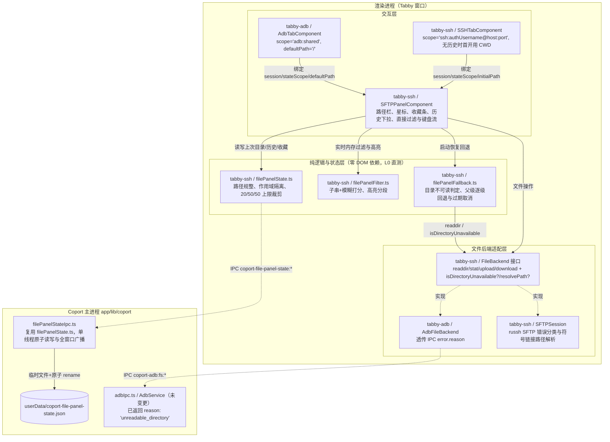
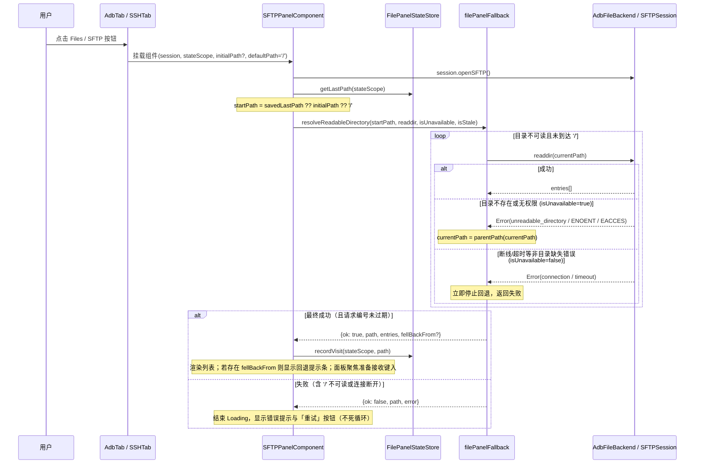
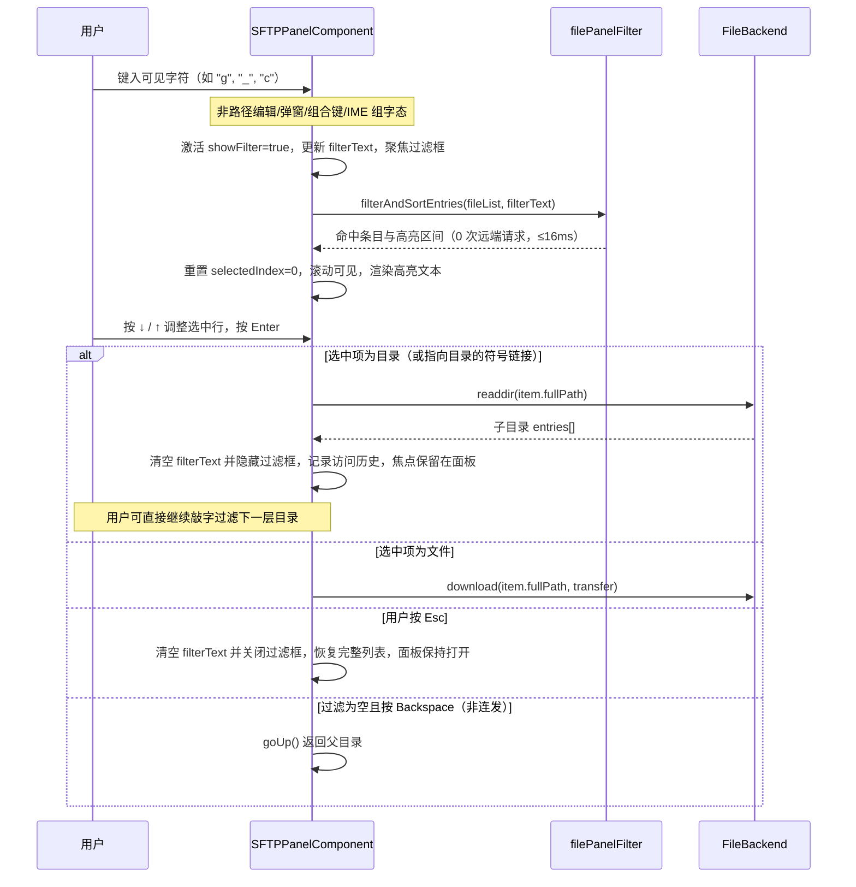

# 文件面板状态保值、收藏与键盘快速过滤

交付分级：**M**。本方案在单仓库 `/Users/shenyue/project/coport-tabby` 内增强 `tabby-ssh` 与 `tabby-adb` 共用的文件面板（`SFTPPanelComponent`），解决 ADB 首次打开写死 `/sdcard` 卡死 `Loading`、无上次目录保值、无收藏与无输入即过滤的问题。本次为完整范围定版方案，可一次交付。

## 需求与验收

目标：让 Coport 的 ADB 与 SSH 文件面板具备状态保值、异常自动回退、一键收藏与最近目录跳转，以及 Total Commander / VSCode 风格的「直接输入即过滤 + 纯键盘逐层钻取」体验。
范围：共用 `sftp-panel` 的启动路径解析与逐级回退、持久化状态存储（ADB 全局共用 / SSH 按 `user@host:port` 隔离）、星标收藏与最近目录快捷跳转、直接输入即过滤与模糊高亮、键盘导航闭环、路径栏单击编辑、ADB/SFTP 目录不可读错误区分、L0/L2 自动化测试及上游改动白名单登记。
不做：不改写 MCP 工具与主进程 `coport-adb:*` 跨进程 IPC 协议；不做跨设备/云端同步收藏；不做远端递归全盘搜索（过滤仅针对当前目录内存列表）；不改动原独立 Swift 仓库。

| 需求与类型 | 条件与触发行为 | 用户视角可验证的通过标准（SMART） |
|---|---|---|
| 首次默认目录与状态保值（功能行为） | 无历史时打开 ADB 或 SSH 文件面板；切换至可读目录后关闭面板、重开标签、切换 ADB 设备或重启应用 | 无历史时 ADB 默认打开 `/`（不尝试 `/sdcard`）；SSH 有 CWD 检测结果时首次沿用 CWD，否则打开 `/`。切换至任意可读目录后，重开面板/标签或重启应用，ADB 所有设备共用恢复上次成功打开的目录，SSH 按 `user@host:port` 各自恢复上次成功打开的目录 |
| 目录缺失/不可读自动回退与异常恢复（功能行为） | 恢复的上次目录在当前设备不存在或无权限；或手动跳转至不可读目录；或连 `/` 也因断线/超时失败 | 初始/恢复目标不可读时，自动逐级向上尝试父目录直至 `/` 展示可读列表，并在面板内给出非阻塞提示（含原目标路径、失败原因与实际打开目录），不卡死在 `Loading`；手动跳转至不可读目录时提示错误并保留当前有效列表；`/` 本身因连接/超时失败时展示错误与「重试」按钮，恢复连接后点击重试可正常列出目录 |
| 收藏与最近目录（功能行为） | 点击路径栏旁星标；打开收藏/最近目录入口点击跳转或移除收藏；跨设备或重启后再次打开 | 星标状态与当前目录收藏状态实时同步；面板内可一键跳转或移除收藏；快捷下拉中收藏展示在最近目录上方；ADB 收藏与最近目录跨设备共用，SSH 按 `user@host:port` 独立保存；重启应用后完整保留 |
| 输入即过滤与纯键盘钻取（功能行为） | 文件面板获得焦点（非路径编辑/弹窗）时直接键入字符，使用 `↑/↓`、`Enter`、`Backspace`、`Esc` | 无需先点 Filter 按钮，直接键入可见字符即实时过滤当前目录的文件与文件夹（大小写不敏感，支持子串与顺序模糊匹配如 `g_c` 命中 `g_comp` 并高亮命中字符）；`↑/↓` 移动选中行，`Enter` 进入选中目录（或下载文件）并清空过滤词、保持面板焦点以连续敲字钻取；过滤为空时 `Backspace` 返回上级目录；`Esc` 清空过滤且不误关文件面板；无匹配时显示提示并保留返回上级入口 |
| 路径栏编辑与既有能力回归（功能行为） | 单击路径栏空白区或编辑入口修改路径并回车/`Esc`；执行上传、下载、拖拽、新建目录、删除、符号链接与右键菜单 | 单击（兼保留双击）可编辑/粘贴绝对路径，回车跳转、`Esc` 恢复；ADB 与 SSH 下既有文件操作全部回归通过，过滤态下点击、右键和 `Enter` 均作用于实际选中的文件条目 |
| 过滤响应与容量上限（性能与规模） | 当前目录含 1,000 个条目时连续键入过滤；反复访问超过 20 个目录、收藏超过 50 个目录、连接超过 50 个 SSH 主机 | ① 1,000 条目下单次键入的本地过滤耗时 ≤ 16 ms，且触发 0 次远端 `adb`/`sftp` 列表请求；② 每作用域最近目录上限 20 条（规范化路径去重、最近置顶），收藏上限 50 条（去重、保留最新 50 条），SSH 作用域上限 50 个（按最近使用时间 LRU 淘汰且永不淘汰 ADB 作用域），超限时自动裁剪不报错、不丢失最新写入项 |

## 业界方案调研与选型依据

围绕三个关键设计问题展开调研：直接输入即过滤与键盘导航交互模式、前端轻量模糊匹配与高亮方案、Electron/Tabby 渲染端状态持久化机制。查证日期：2026-11-27。

| 候选方案与复用方式 | 可复用能力、适配成本与适用边界 | 成熟度及关键假设证据 | 来源及版本／查证日期 | 取舍依据 |
|---|---|---|---|---|
| VS Code Tree/List Find + Filter 模式（跨行业交互借鉴） | 焦点在列表时直接敲字激活增量过滤，支持模糊匹配、命中字符高亮、`↑/↓/Enter/Esc` 键盘导航，进入新上下文清空过滤 | 已有充分证据：VS Code 生产默认交互模式 | [VS Code User Interface / List Navigation](https://code.visualstudio.com/docs/getstarted/userinterface)（2026-11-27 查证） | 采用其直接敲字过滤、命中高亮与键盘闭环语义，简化为单层目录面板（不引入复杂树展开） |
| Total Commander Quick Filter（跨行业交互借鉴） | 面板内直接输入即增量隐藏不匹配项，`Esc` 立即还原完整列表，适合高频目录钻取 | 已有充分证据：Total Commander 长期稳定特性 | [Total Commander Quick Search / Quick Filter](https://www.ghisler.ch/wiki/index.php/Quick_search)（2026-11-27 查证） | 采用其「直接输入默认过滤而非仅跳转光标」与 `Esc` 还原语义 |
| 仓库既有 `fuzzy-search`（评估复用） | `tabby-core` 的 `SelectorModalComponent` 已依赖 `fuzzy-search`，可做基础模糊筛选 | 有条件可用：仅返回匹配对象数组，不提供命中字符索引区间，且 `tabby-ssh/package.json` 未声明该依赖 | 仓库源码 `tabby-core/src/components/selectorModal.component.ts:4`（2026-11-27 核实） | 排除。无法在不二次扫描/自研的前提下提供命中字符高亮与可控的分级排序，且不希望为上游 `tabby-ssh` 新增第三方依赖 |
| 轻量自研顺序子序列 + 子串分级匹配器（必要自研） | ~80 行零依赖纯 TypeScript 函数，一次遍历完成精确/前缀/子串/子序列分级打分并返回合并后的 `[start, end)` 高亮区间，1,000 条目耗时 < 2 ms | 已有充分证据：无外部依赖，纯算法可直接在 L0 `node --test` 验证性能与边界 | 本文设计 `tabby-ssh/src/utils/filePanelFilter.ts` | 采用。零新增依赖、满足 ≤ 16 ms 性能指标、支持安全模板分段渲染（无 `innerHTML`） |
| Tabby 主进程原子文件存储（借鉴本仓库串口参数落盘模式） + 纯逻辑 `FilePanelStateStore` 引擎 | 主进程单线程串行执行时间戳分配、写入与 50 主机 LRU 裁剪，通过临时文件 + 原子 `rename` 持久化到 `userData/coport-file-panel-state.json`，并向所有窗口广播变更；非 Electron/单测环境可回退至 `StorageLike` | 已有充分证据：本仓库 `app/lib/coport/` 已有成熟主进程 IPC 与隔离 `userData` 机制，彻底消除多窗口 `localStorage` 并发写/裁剪竞态 | 仓库源码 `app/lib/index.ts`、`app/lib/coport/adbIpc.ts`（2026-11-27 核实） | 采用。单一纯逻辑引擎被主进程 IPC 与 L0 单测共用（零重复实现），天然随 Electron `--user-data-dir` 隔离，同窗/跨窗多标签自动实时同步 |
| Tabby `ConfigService` / `config.yaml`（评估复用） | 适合用户显式编辑的配置项，但高频目录切换会频繁触发全量 YAML 序列化落盘，且目录路径属于运行态导航历史而非静态配置 | 已有充分证据：Tabby 自身亦将 `recentProfiles` 等高频导航状态放入 `localStorage` 而非 `config.yaml` | 仓库源码 `tabby-core/src/services/config.service.ts`（2026-11-27 核实） | 排除。避免高频 `cd` 导致 `config.yaml` 反复写盘和与用户手动编辑配置冲突 |

无阻塞技术假设，无需前置预研。所有依赖（Angular 15 宿主事件与模板渲染、`window.localStorage`、`FileBackend`、Node 22 `node --test`、`coport_shells.mjs` Electron+ADB+sshd 仿真套件）均已在当前仓库运行并验证。

## 目标架构与影响范围

运行边界位于渲染进程与主进程之间：面板 UI、过滤与回退逻辑驻留在渲染进程的 `tabby-ssh` 与 `tabby-adb` 内；主进程 `adbIpc.ts` / `adbService.ts` 保持零改动，仅在 `app/lib/coport/` 新增轻量主进程状态存储 IPC（`filePanelStateIpc.ts`），复用同一份纯逻辑 `filePanelState.ts` 引擎为多窗口提供单点原子读写、严格递增时间戳、LRU 裁剪与全窗口变更广播。下图中实线箭头表示调用或数据读写方向，虚线表示事件或跨进程 IPC。

源码定位与设计提议：
- 既有模块：`tabby-ssh/src/components/sftpPanel.component.{ts,pug,scss}`、`tabby-ssh/src/components/sshTab.component.{ts,pug}`、`tabby-ssh/src/api/fileBackend.ts`、`tabby-ssh/src/session/sftp.ts`、`tabby-ssh/src/index.ts`、`tabby-adb/src/adbTab.component.ts`、`tabby-adb/src/adbPanel.pug`、`tabby-adb/src/adbFileBackend.ts`、`app/lib/coport/adbIpc.ts`、`app/lib/coport/adbService.ts`。
- 新增设计提议模块：`app/lib/coport/filePanelStateIpc.ts`、`tabby-ssh/src/utils/filePanelState.ts`、`tabby-ssh/src/utils/filePanelFilter.ts`、`tabby-ssh/src/utils/filePanelFallback.ts`、`tabby-ssh/test/filePanelNavigation.test.ts`。

影响范围：
- **业务与 UI 改动**：上述 `tabby-ssh` 与 `tabby-adb` 文件。
- **测试与校验配套**：新增 `tabby-ssh/test/filePanelNavigation.test.ts`（L0）；扩展 `scripts/coport/sim/coport_shells.mjs` 与 `scripts/coport/sim/prepare_adb.py`（L2）；更新 `docs/coport/upstream-changes.md` 登记新增路径并通过 `scripts/coport/check-upstream-diff.mjs`。
- **对外协议说明**：无对外协议（MCP、IPC、SSH/ADB 线协议）变更；仅扩展渲染进程内部可选接口 `FileBackend.isDirectoryUnavailable?`。

### 关键设计取舍与代选记录（低风险自动准出）

用户在 G1 已确认采用「共用 `sftp-panel`（选项 B）」与「ADB 全局共用 + SSH 按 `user@host:port` 隔离（选项 A）」。以下低风险实现取舍由编排方在 G1 授权范围内代选并记录依据：
1. **将纯状态、过滤、回退拆为 `tabby-ssh/src/utils/` 零 Angular 依赖模块**：最小改动可直接堆进 `sftpPanel.component.ts`，但拆出纯模块后既减少对上游大文件的行级冲突，又让 L0 `node --test` 能无头直接覆盖全部边界与 1,000 条目性能阈值。
2. **模糊匹配排序策略**：输入非空过滤词时，按「匹配档位（精确 > 前缀 > 连续子串 > 顺序子序列）→ 目录优先于文件 → 名称字典序」排序，保证最优命中排在第 0 行，配合 `Enter` 实现一步直达；过滤词为空时保持既有「目录优先 → 名称字典序」。
3. **过滤态下的 `Backspace` 防误触**：仅当过滤输入框未处于有内容编辑态且事件非长按连发（`!event.repeat`）且过滤词为空时，`Backspace` 触发 `goUp()`，避免用户按住 `Backspace` 清空过滤词时意外退回上级目录。
4. **单窗口/多窗口状态一致性**：Electron 运行时由主进程 `filePanelStateIpc.ts` 持有唯一 `FilePanelStateStore` 实例并在单线程内完成时间戳分配、写入、50 主机 LRU 裁剪与原子文件落盘（`userData/coport-file-panel-state.json`），随后向所有打开窗口广播 `coport-file-panel-state:changed`，彻底杜绝多窗口并发裁剪误删或同毫秒时间戳冲突；单测及非 Electron 环境复用同一纯逻辑引擎并支持 `StorageLike` 回退（写入失败时保留内存副本不被旧磁盘值覆写）。
5. **面板布局与遮挡控制**：
   - 顶栏（`.header`）：路径面包屑（单击空白区或铅笔按钮进入编辑态，保留原双击） + 星标收藏按钮 + 收藏/历史下拉触发按钮 + Refresh / Filter / Create directory / Upload files / Upload folder / Close。
   - 收藏快捷条（`.favorites-bar`，有收藏时显示）：单行可横向滚动的紧凑标签芯片，点击直达，悬浮/尾部小 `×` 移除。
   - 快捷过滤栏（`.filter-bar`，直接敲字或点 Filter 时展开）：紧贴列表上方，显示过滤词、匹配计数与清除按钮。
   - 回退/异常提示条（`.status-banner`，仅在自动回退或错误时出现）：非阻塞展示原目标、原因、实际打开路径及关闭/重试按钮。
   - 列表区（`.body`）：高亮选中行（`.selected`），无匹配时保留 `Go up` 入口；全区域阻止点击冒泡到 `SSHTabComponent` 的关闭监听。

## 交互过程

### 场景一：面板初始化、状态恢复与目录不可读逐级回退

打开 ADB 或 SSH 文件面板时触发，覆盖有/无历史恢复、不可读逐级回退、根目录失败可重试与并发切换取消。

### 场景二：直接键入过滤与纯键盘逐层钻取

用户在已打开的文件面板中直接敲字筛选并按 `Enter` 连续进入子目录或按 `Backspace`/`Esc` 控制过滤。

## 交互协议

本功能不涉及跨进程或网络协议变更，以下定义渲染进程内部模块契约与持久化存储结构，确保实现与 L0/L2 测试精确对齐。

### 内部契约一：`FileBackend` 目录不可读判定与路径解析扩展

供 `SFTPPanelComponent` 区分「目录不存在/无权限（可向上回退）」与「设备离线/通道断开/超时（应立即报错并允许重试）」，并在 SSH 含 `..` 路径下准确解析服务器真实目录身份以识别根目录。

| 项目 | 定义 |
|---|---|
| 调用方 / 实现方 | `tabby-ssh/src/components/sftpPanel.component.ts` → `AdbFileBackend` / `SFTPSession` |
| 入口签名 | `FileBackend.isDirectoryUnavailable?: (error: unknown) => boolean`；`FileBackend.resolvePath?: (path: string) => Promise<string>` |
| ADB 适配 | `adbFileBackend.ts` 在 `adbRequest` 抛出的 `Error` 上保留 `reason: string` 属性；`isDirectoryUnavailable` 仅在 `error.reason === 'unreadable_directory'` 时返回 `true` |
| SFTP 适配 | `SFTPSession.isDirectoryUnavailable` 当错误包含 SFTP 缺失/权限语义（`No such file`、`Permission denied`、`Not a directory`、`ENOENT`、`EACCES`、`ENOTDIR` 或对应状态码 `2`/`3`）时返回 `true`；连接断开、超时、channel closed 返回 `false`。`SFTPSession.resolvePath` 在路径包含 `..` 时通过 `readlink` 按服务器符号链接语义解析真实规范路径（无 `..` 路径不增加额外往返），抵达 `/` 时准确收敛为 `'/'` |

### 内部契约二：主进程原子持久化结构（`userData/coport-file-panel-state.json` 与 `coport-file-panel-state:*` IPC）

主进程 `app/lib/coport/filePanelStateIpc.ts` 复用 `tabby-ssh/src/utils/filePanelState.ts` 的唯一状态引擎，以临时文件 + 原子 `rename` 持久化全部作用域（键为 `'adb:shared'` 或 `'ssh:<authUsername>@<host>:<port>'`，SSH 优先取已认证的 `authUsername`，缺失时回退配置 `user`），并通过 `coport-file-panel-state:op`（同步调用，仅限主窗口主 frame）与 `coport-file-panel-state:changed`（全窗口广播）向渲染进程提供服务；非 Electron 环境回退为 `FilePanelStateStore` + `StorageLike`。

| 字段路径 | 类型 | 必填 | 含义 | 约束 |
|---|---|---|---|---|
| `version` | `number` | 是 | 结构版本 | 固定为 `1`；非 `1` 或非法 JSON 时按空状态降级 |
| `scopes[key].recent` | `string[]` | 是 | 最近成功打开的目录列表 | 规范化绝对路径（保留合法目录名尾随空格、区分大小写去重），最近访问排首位（`recent[0]` 即上次目录），上限 **20** |
| `scopes[key].favorites` | `string[]` | 是 | 收藏目录列表 | 绝对路径，区分大小写去重，上限 **50**（新增超出上限时保留最新 50 条） |
| `scopes[key].updatedAt` | `number` | 是 | 最近更新时间戳（ms） | 在主进程单线程内严格递增；`ssh:*` 键总数上限 **50**，超限时按 `updatedAt` 淘汰最久未更新项，永不淘汰当前写入作用域与 `'adb:shared'` |

场景处理规则：

| 场景 | 处理规则 |
|---|---|
| 手动跳转到不存在的目录 | 不触发父级回退、不清空当前有效 `fileList`、不写入 `recent`，仅显示错误提示 |
| 快速连续切换目录 / 切换时关闭面板 | 递增 `navigation` 请求号；过期异步回调直接丢弃，不更新列表、不覆盖路径、不写历史 |
| 过滤状态下执行点击、右键、Enter 或删除 | 全部操作绑定到 `filteredFileList` 中的实际 `SFTPFile` 对象，不按原始未过滤数组下标索引 |
| `localStorage` 数据损坏或写入抛出 `QuotaExceededError` | 读取回退为空状态；写入捕获异常并保持当前内存态正常工作，不中断面板浏览 |

### 内部契约三：组件输入与属性约定（`SFTPPanelComponent`）

| 输入属性 | 类型 | 默认值 | 含义与调用方绑定 |
|---|---|---|---|
| `stateScope` | `string \| null` | `null` | 状态作用域键；`AdbTabComponent` 传 `'adb:shared'`，`SSHTabComponent` 传 `'ssh:${authUsername || user}@${host}:${port}'`；为 `null` 时仅内存工作不读写存储 |
| `defaultPath` | `string` | `'/'` | 无历史且无初始路径时的默认目录；`AdbTabComponent` 不再硬编码 `/sdcard`，改用 `'/'` |
| `path` | `string \| null` | `null` | 可选初始路径（如 SSH 检测到 CWD 时传入；仅在该作用域尚无 `savedLastPath` 时生效，已有上次目录时始终优先恢复 `savedLastPath`） |

## 验收矩阵

以下为计划验证，尚未执行。级别：L0 静态与单元／L1 主机集成／L2 仿真环境／L3 真实设备·脚本驱动／L4 真实设备·人工操作。

| 用户场景／验收项 | 级别 | 自动化入口（L0–L3）／验收方式 | 用户视角通过标准与证据 |
|---|---|---|---|
| 状态存储、作用域隔离与容量上限（20 历史 / 50 收藏 / 50 SSH 主机） | L0 | `npm run test:ssh-term`（新增 `tabby-ssh/test/filePanelNavigation.test.ts`，设计提议） | ADB 共用与 SSH 按 `user@host:port` 隔离互不干扰；路径规范化与大小写去重正确；历史超 20 保留最新 20，收藏超 50 保留最新 50，SSH 主机超 50 按 LRU 淘汰且不删 ADB；损坏 JSON 与写入异常不崩溃。证据：测试退出码 0 及用例名输出 |
| 目录不可读逐级回退与瞬时错误不误回退 | L0 | `npm run test:ssh-term`（新增 `tabby-ssh/test/filePanelNavigation.test.ts`，设计提议） | 缺失/无权限路径逐级回退至最近可读父级并返回原目标与原因；断线/超时错误立即终止回退；并发过期请求结果被丢弃。证据：测试退出码 0 及用例名输出 |
| 子串与模糊匹配、排序、高亮区间及 1,000 条目性能阈值 | L0 | `npm run test:ssh-term`（新增 `tabby-ssh/test/filePanelNavigation.test.ts`，设计提议） | 大小写不敏感子串与顺序模糊（如 `g_c`→`g_comp`）命中准确，高亮区间合并正确；1,000 条目单次过滤耗时 ≤ 16 ms（取多次实测最大值或 P95 均达标）。证据：测试退出码 0 及实测耗时日志 |
| ADB 无 `/sdcard` 首次启动、保值恢复、跨设备共享与异常重试 | L2 | `node scripts/coport/sim/coport_shells.mjs`（扩展既有场景，设计提议） | 伪 ADB 设备不含 `/sdcard` 时，首次打开 Files 默认成功进入 `/`（不卡 `Loading`）；切换目录后重启隔离 Electron 实例仍恢复该目录，换第二台伪 ADB 设备共享恢复；若保存目录在新设备缺失则自动回退到可读父目录并显示回退提示条；根目录断线失败显示错误与重试按钮，恢复后点击重试列出目录。证据：脚本退出码 0 及断言日志 |
| SSH SFTP 按主机/账号隔离保值、首次 CWD 优先、逐级回退与通道恢复 | L2 | `node scripts/coport/sim/coport_shells.mjs`（扩展既有本机 sshd 场景，设计提议） | SSH SFTP 面板按 `authUsername@host:port` 独立保存上次目录与收藏，不与 ADB、其他主机或同主机其他账号串数据；无历史且提供 CWD 时首次打开使用 CWD，已有历史后重开/重启优先恢复上次目录；真实 sshd 下缺失/无权限目录触发逐级回退并提示；SFTP 通道关闭后点击 Retry 可重建通道恢复浏览。证据：脚本退出码 0 及断言日志 |
| 收藏星标、快捷条与历史下拉跳转和移除 | L2 | `node scripts/coport/sim/coport_shells.mjs`（扩展既有场景，设计提议） | 星标切换收藏并持久保存；快捷条与下拉菜单中收藏排在最近目录之前；点击一键跳转、移除收藏后星标同步取消且最近目录仍保留。证据：脚本退出码 0 及断言日志 |
| 直接敲字即过滤、键盘逐层钻取、零远端请求与 1,000 条目实时响应 | L2 | `node scripts/coport/sim/coport_shells.mjs`（扩展既有场景，设计提议） | 未点击 Filter 按钮时向面板派发字符键即自动展开过滤并筛选列表，过滤期间 `readdir` 计数增加 0；`↑/↓` 移动选中行、`Enter` 进入子目录后自动清空过滤并保持面板焦点可继续键入；过滤为空时 `Backspace` 返回上级；`Esc` 清空过滤且面板保持打开；无匹配时显示提示并保留 `Go up`；1,000 条目目录下界面过滤耗时 ≤ 16 ms。证据：脚本退出码 0 及耗时/计数断言日志 |
| 路径栏单击编辑与既有上传/下载/删除/拖拽/右键回归 | L2 | `node scripts/coport/sim/coport_shells.mjs`（既有 + 扩展场景） | 单击路径空白区编辑路径并回车跳转、`Esc` 取消恢复；过滤状态下点击/Enter/右键作用于实际选中项；既有 ADB 与 SSH 上传、下载、目录上传、新建目录、删除、符号链接回归全部通过。证据：脚本退出码 0 |
| 代码规范、构建打包与上游改动白名单门禁 | L0 | `npm run lint`、`npm run build`、`node scripts/coport/check-upstream-diff.mjs`、`npm run test:unit` | Lint 0 错误、构建产物生成、白名单校验 0 未登记路径、既有单测通过。证据：各命令退出码 0 |

### 人工验收项（L4 · 用户视角）

| 用户场景 | 无法脚本化原因 | 用户动作 | 预期体验与 agent 判定依据 |
|---|---|---|---|
| 真实无 `/sdcard` ADB 设备（及可选 SSH）端到端交互手感与视觉观感 | 真实嵌入式硬件板卡环境、视觉布局与遮挡观感、连续纯键盘钻取节奏的主观流畅度需人亲自体验 | 安装构建后的 `/Applications/Coport.app`，连接真实 ADB 设备打开 Files 面板：① 验证首次不报 `/sdcard` 错且能列出目录；② 切换目录并重启 App 验证保值；③ 点星标收藏并从快捷入口跳转/移除；④ 不点 Filter 直接连续敲字过滤并用 `↑/↓/Enter/Backspace/Esc` 逐层浏览，确认无遮挡、无卡顿、无误关面板 | 用户确认交互顺手、布局清晰无遮挡、全部四步符合预期；agent 核对安装构建版本与被测提交 SHA，采纳用户结论（本项聚焦真实设备观感与手感，需人工判定） |
